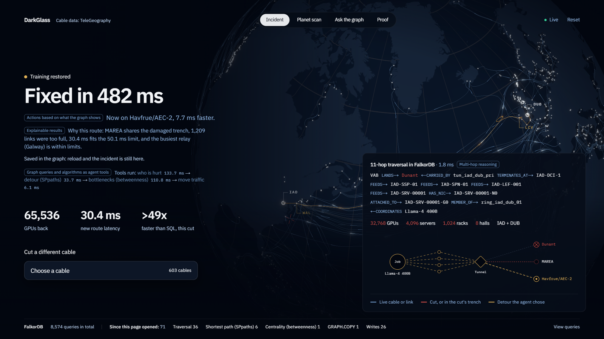
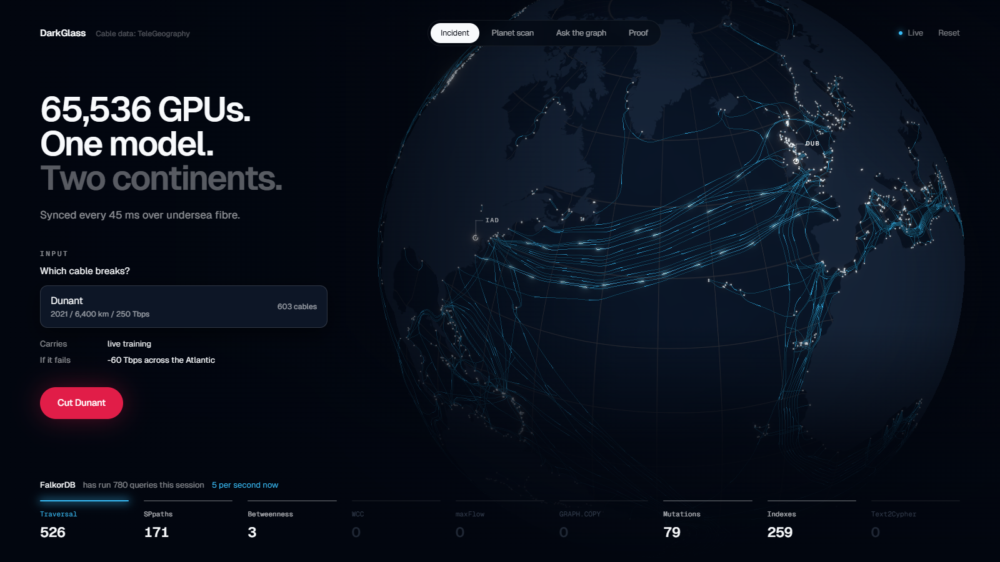
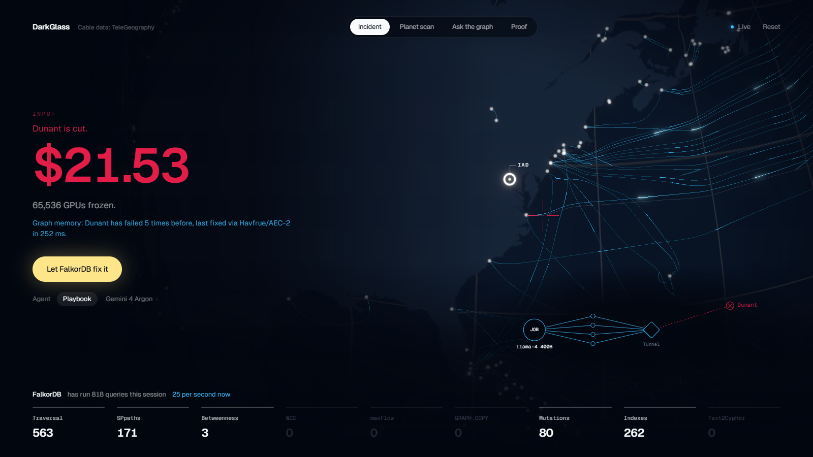
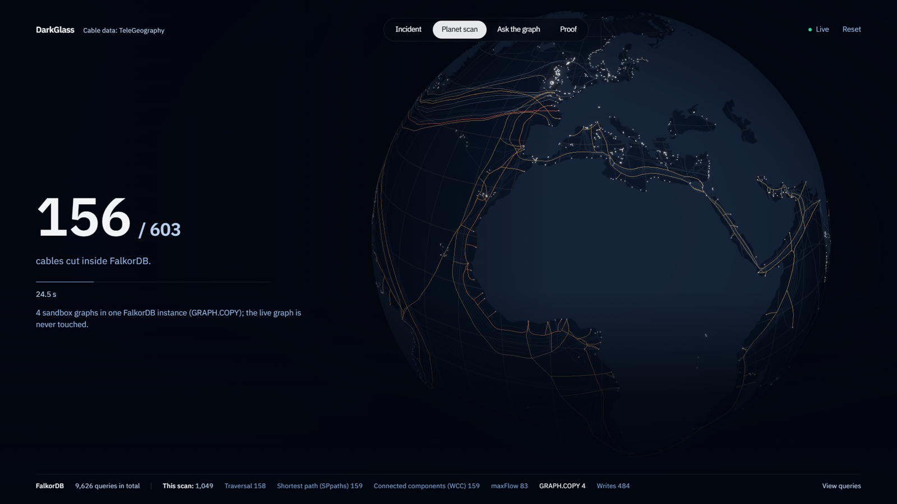
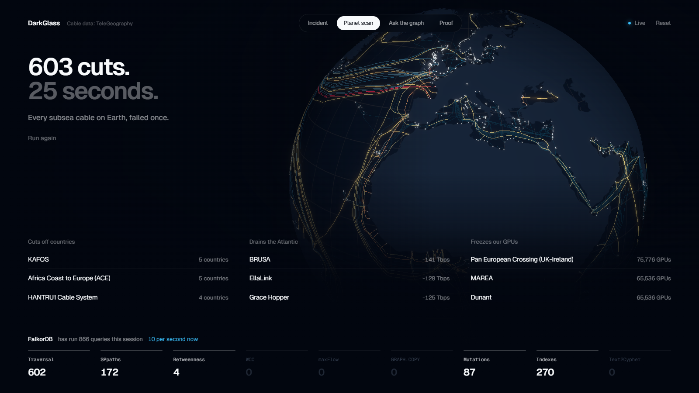
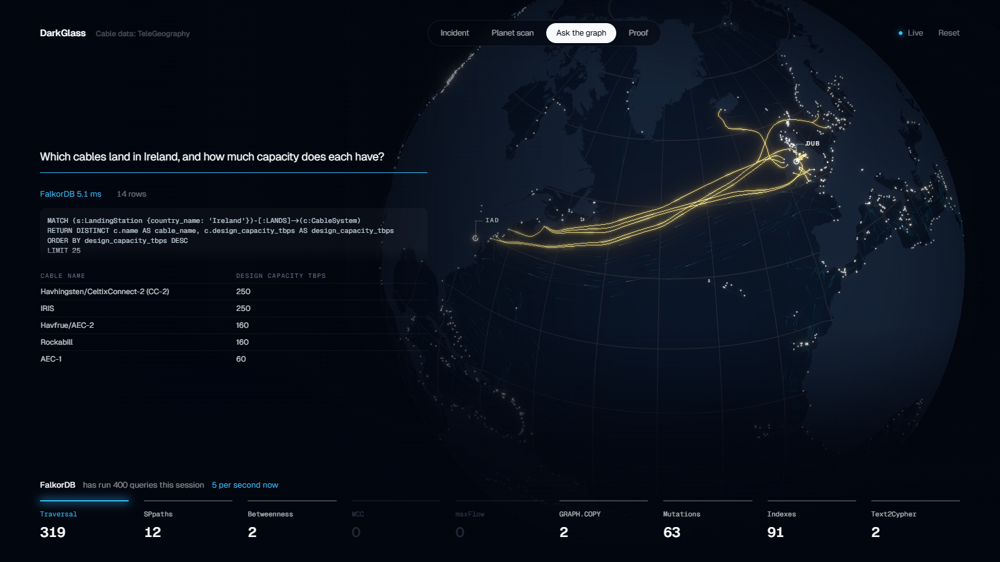
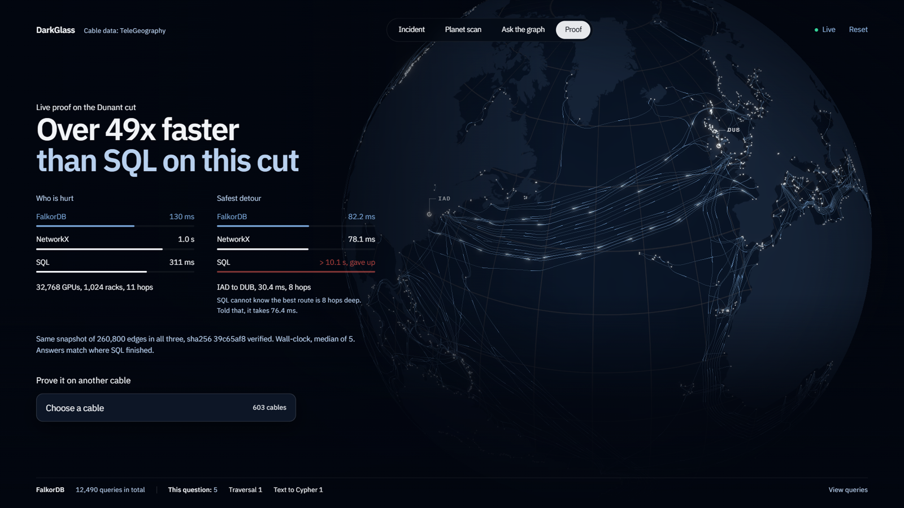

# DarkGlass

**Self-healing networks for AI supercomputers, running on FalkorDB.**
WeMakeDevs x FalkorDB Graph Hacks, Track 01: Agents That Act on Connected Data.

**🌐 [Live demo](https://8-234-112-123.sslip.io)** · **▶ [Demo video (3 min)](https://youtu.be/-fh9tKQJ4Z8)** · **[Blog: 419 milliseconds](https://darkglass-blog.onrender.com)** ([also on dev.to](https://dev.to/soujas_k_1ab6dcabf6a196f3/419-milliseconds-how-a-graph-saved-65536-gpus-from-a-ships-anchor-2g4g)) · **[Run it locally](#run-it)**



A 65,536-GPU training run spans Ashburn and Dublin. It syncs every 45 ms over undersea fibre, so
when a ship's anchor cuts one cable, every GPU freezes and the job burns about $5 a second.
DarkGlass keeps the real subsea network (603 cables and 1,788 landing stations from TeleGeography)
and the AI supercluster down to every GPU (jobs, sync rings, tunnels, border routers, Clos switches,
servers, NICs, GPUs, racks and halls: about 166,000 nodes) in **one FalkorDB graph**. An agent works
out who is hurt with an 11-hop traversal from the seabed to the GPU, finds the fastest detour that
avoids the damaged trench, checks it for bottlenecks, and moves the traffic. FalkorDB's part of the
fix takes under half a second; with Gemini choosing the tools, the whole fix takes 35 to 50 s.

## Track 01 key focus: where to see each one

Each item is also labelled in the app with a small tag carrying the same name.

| Key focus | Where to see it | Code |
|---|---|---|
| **Multi-hop reasoning** | Cut a cable. The graph panel shows the 11-hop traversal from landing station to cable, tunnel, border router, three switch tiers, server, NIC, GPU, ring and job, with the GPUs, servers, racks and halls it reaches | `PATH`, `IMPACT` in `mcp_server/tools/blast_radius.py` |
| **Graph queries and algorithms as agent tools** | The four steps while the agent works, and "Tools Gemini chose" on the result: the traversal, `algo.SPpaths`, `algo.betweenness`, and an atomic write. The planet scan adds `algo.WCC`, `algo.maxFlow` and `GRAPH.COPY` | `mcp_server/tools/` |
| **Tool selection through MCP** | "Gemini 3.8 Flash is choosing tools over MCP": the agent discovers the tools with MCP `list_tools` and calls the ones it picks with `call_tool` | `mcp_server/gemini_agent.py`, `mcp_server/server.py` |
| **Actions based on what the graph shows** | "Now on Havfrue/AEC-2": the detour's limits come from the traversal's answer, MAREA is excluded because the graph puts it in the same trench, then bandwidth is reserved and the tunnel's `CARRIED_BY` edge moves. The fix is written to graph memory | `mcp_server/tools/spectrum_allocator.py`, `backend/app/services/chaos_engine.py` |
| **Explainable results** | "Why this route", each tool's exact Cypher (click it), Gemini's summary, "Not fixed yet" for traffic left behind, and the Proof tab, which answers the same cut in FalkorDB, NetworkX and SQL | `frontend/src/components/hud/Chapter.tsx`, `backend/app/services/live_proof.py` |

## FalkorDB features used, in FalkorDB's own terms

Times are in the demo video; the same wording is on screen in the app.

| FalkorDB feature | How DarkGlass uses it | In the app | Video |
|---|---|---|---|
| **MCP** | Gemini discovers DarkGlass's four FalkorDB tools with MCP and picks each one itself | "choosing tools over MCP", tag "Tool selection through MCP" | 0:37 |
| **Query with Cypher** | An 11-hop traversal finds who is hurt; writes move the traffic; Ask the graph turns English into read-only Cypher | Every tool and figure opens its exact Cypher | 0:45, 1:42, 2:25 |
| **Graph algorithms as agent tools: Shortest path** | `algo.SPpaths` finds the fastest detour that avoids the damaged trench | Engine bar: "Shortest path (SPpaths)"; tool "detour (SPpaths)" | 0:54 |
| **Centrality** | `algo.betweenness` checks the detour for overloaded relay stations | Engine bar: "Centrality (betweenness)"; tool "bottlenecks (betweenness)" | 1:02 |
| **Connected components** | `algo.WCC` finds the landing stations each failure cuts off | Engine bar: "Connected components (WCC)" during the planet scan | 2:11 |
| **Max flow** (beyond the list) | `algo.maxFlow` measures North America to Europe capacity after each failure | Engine bar: "maxFlow"; board "Drains the Atlantic" | 2:11 |
| **Isolated graphs in one instance** | `GRAPH.COPY` makes 4 sandbox graphs for the planet scan, and one for the proof; the live graph is never touched | "4 sandbox graphs in one FalkorDB instance (GRAPH.COPY)" | 1:57 |
| **Context that persists across sessions** | Each agent step writes to the graph (span cut, bandwidth reserved, tunnel moved); a reload or restart finds the incident and its result | "Saved in the graph: reload and the incident is still here" | 1:35 |
| **Explore the graph: FalkorDB Browser** | The same graph opens in FalkorDB Browser at http://localhost:3001 (log in with the defaults, pick `darkglass_core`) | Drawer: "Open in FalkorDB Browser" | 1:48 |

Not used: PageRank, community detection, and the GraphRAG-SDK / LangChain / LlamaIndex style integrations;
DarkGlass talks to FalkorDB through MCP and Cypher directly.

## What you see

| | |
|---|---|
|  | **Incident.** Pick any of the 603 cables from the searchable list and cut it. |
|  | **Input.** The cable goes dark, a counter shows the money burning, and FalkorDB recalls past failures of this cable from its incident memory. |
|  | **Output.** The agent (Gemini 3.8 Flash choosing the queries itself over MCP, or a deterministic playbook) restores training. The graph view shows the 11-hop path FalkorDB walked, the GPUs, servers, racks and halls behind the cut, and the tunnel's `CARRIED_BY` edge moving to the new cable. |
|  | **Planet scan.** FalkorDB cuts every one of the 603 cables, one at a time, in four parallel sandbox copies of the graph. The globe becomes a risk heat map. |
|  | The worst cables for the planet (landing stations stranded from the subsea network), for transatlantic capacity, and for our GPUs (GPUs whose gradient sync would freeze). |
|  | **Ask the graph.** Gemini writes the Cypher, FalkorDB answers in milliseconds, and the answer lights up on the globe. |
|  | **Proof.** The cut you just made, answered live in FalkorDB, Python NetworkX and SQL on the same hash-checked snapshot. |

The bar along the bottom of every screen is the **live FalkorDB engine**. Each capability lights up
when FalkorDB actually runs it, with real call counts taken from query telemetry.

## Why FalkorDB is the core of this

> **Why it has to be a graph.** "Who is hurt" is one 11-hop path across four layers, from the seabed
> through the cable, tunnel and switch fabric down to the GPU and its job: a single Cypher pattern,
> or 11 joins in SQL. "Where do we move it" is worse. The safest detour has no fixed depth, so SQL
> needs a recursive search: it takes 1,770 ms when capped at 12 hops, misses the best route below 8,
> and does not finish in 10 s without a cap. FalkorDB's `algo.SPpaths` answers in 0.8 ms.

| FalkorDB capability | What it does here |
|---|---|
| Multi-hop Cypher traversal | "Who is hurt?": one 11-hop path from landing station to cable, tunnel, border router, super-spine, spine, leaf, server, NIC, GPU, sync ring and job, plus a sweep that locates every affected GPU to its server, rack, hall and campus (32,768 GPUs for Dunant in about 0.15 s) |
| `algo.SPpaths` | The fastest detour that avoids the damaged trench and has enough free capacity |
| `algo.betweenness` | Checks the detour for overloaded relay stations |
| `algo.WCC` | Planet scan: which landing stations fall off the main subsea network after each failure, and in which countries. A stranded station is not a country offline: inland fibre is not modelled |
| `algo.maxFlow` | Planet scan: total North America to Europe capacity left after each failure (multi-source, multi-sink) |
| `GRAPH.COPY` | Planet scan: four sandbox copies of the planet run in parallel; production is never touched |
| Live mutations | Cuts, atomic all-or-nothing bandwidth reservation, tunnel rebinding, scan results written back |
| Edge indexes | Index-backed lookups on cable, risk group, status and capacity |
| Graph as memory | Each resolved incident is stored as `(:Incident)-[:SEVERED]->(:CableSystem)` and `-[:REROUTED_VIA]->`. The agent recalls it the next time that cable fails |
| Text to Cypher | Ask the graph: Gemini 3.8 Flash writes Cypher, which runs under `GRAPH.RO_QUERY`, so a generated query can never write |

## Graph data model

One graph, `darkglass_core`, holds four layers: about 166,000 nodes and 261,000 relationships.

```
Physical plant (TeleGeography)
(:LandingStation {code, name, country_name, lat, lon})-[:OPTICAL_SPAN {cable_id, srlg_id, length_km,
    latency_ms, max_capacity_tbps, available_capacity_tbps, route_weight, status}]->(:LandingStation)
(:LandingStation)-[:LANDS]->(:CableSystem {id, name, design_capacity_tbps, ready_for_service, length_km, owners})
A cut retypes a cable's spans to :SEVERED_SPAN.

Workloads
(:TrainingJob)-[:COORDINATES]->(:NCCL_Ring)-[:USES_TUNNEL]->(:LogicalTunnel)-[:CARRIED_BY]->(:CableSystem)

Compute fabric (Ashburn IAD and Dublin DUB)
(:LogicalTunnel)-[:TERMINATES_AT]->(:BorderRouter)-[:FEEDS]->(:SuperSpine)-[:FEEDS]->(:Spine)
    -[:FEEDS]->(:Leaf)-[:FEEDS]->(:Server)-[:HAS_NIC]->(:NIC)-[:ATTACHED_TO]->(:GPU)-[:MEMBER_OF]->(:NCCL_Ring)
(:Server)-[:IN_RACK]->(:Rack)-[:IN_ROW]->(:Row)-[:IN_HALL]->(:DataHall)-[:IN_CAMPUS]->(:LandingStation)

Memory and analysis
(:Incident)-[:SEVERED]->(:CableSystem), (:Incident)-[:REROUTED_VIA]->(:CableSystem)
(:ResilienceScan)-[:RANKED {rank, risk}]->(:CableSystem)
:FLOW_LINK  derived whole-Gbps layer for algo.maxFlow
```

The fabric's `FEEDS` edges are each device's primary uplink, so every GPU has exactly one path to
its border routers. Real Clos fabrics are multi-pathed; the tree is the forwarding view a blast
radius needs, and it keeps the 11-hop query exact.

## Cypher queries and algorithms

| Where | What |
|---|---|
| `mcp_server/tools/blast_radius.py` | 11-hop `PATH` traversal, the GPU `IMPACT` sweep, shared-trench exposure, incident memory recall |
| `mcp_server/tools/detour_finder.py` | Route-weight masking, then `algo.SPpaths` (k=3, weighted, capacity-checked), then restore |
| `mcp_server/tools/centrality_auditor.py` | `algo.betweenness` (32-source sample, fixed seed) |
| `mcp_server/tools/spectrum_allocator.py` | Atomic capacity reservation, backup demotion, `CARRIED_BY` rebinding |
| `backend/app/services/resilience_scan.py` | `GRAPH.COPY` sandboxes, `algo.WCC`, `algo.maxFlow` |
| `backend/app/services/chaos_engine.py` | Cuts (edge retyping), restores, incident memory writes |
| `backend/app/services/ask_graph.py` | Text to Cypher, run under `GRAPH.RO_QUERY` |
| `backend/app/ingestion/` | Bulk `UNWIND` loads, node and edge indexes |

## Measured results

From `python -m app.services.benchmark` on the development machine. The UI shows the latest run;
nothing is hardcoded. The Proof screen also measures each cut live.

The workload: find the 3 fastest paths Ashburn to Dublin that avoid the damaged Virginia Beach
trench, with at least 3.2 Tbps free on every hop and a 50 ms ceiling. All three engines load the
same `topology.json` (1,790 nodes, 8,900 edges). A sha256 of the edge set, read back from each
engine, confirms they hold identical data, and all three return the same 30.4075 ms route.

| Engine | Task | p50 |
|---|---|---|
| **FalkorDB** `algo.SPpaths` (engine time) | detour search | **0.80 ms** |
| FalkorDB, client wall time incl. network | detour search | 2.04 ms |
| Python NetworkX 3.6 (Yen k-shortest) | detour search | 34.0 ms |
| SQLite recursive CTE (up to 12 hops) | detour search | 1,770 ms |
| **FalkorDB** `algo.betweenness`, 32 sources | bottleneck audit | **22 ms** |
| NetworkX betweenness, 32 sources | bottleneck audit | 131 ms |
| FalkorDB / NetworkX, exact betweenness | bottleneck audit | 830 ms / 7,510 ms |

The SQL time grows exponentially with path length. At 4, 6, 8, 10 and 12 hops it takes 0.8, 4.4,
34.6, 323 and 1,770 ms, and below 8 hops it misses the real best route.

One caveat: the 0.8 ms figure is the search alone. The full detour tool, including masking and
restoring about 1,200 low-capacity links, takes about 50 ms.

Planet scan: 603 failures in 15 to 50 s on the development machine, depending on load. Each scan
runs roughly 600 WCC calls, 300 max-flow runs, 1,800 mutations and 3,000 index lookups.

### Ask the graph: eval

**66 of 69 with Gemini 3.8 Flash (22 of 23 on each of 3 runs), median answer 2.3 s.** Run it with
`python -m app.services.ask_eval` (results in `data/benchmarks/ask_eval.json`).

The 23 questions in `backend/app/services/ask_eval.py` are hand-written and cover lookups (4),
aggregates (6), multi-hop traversals up to 7 hops (9), scan results and incident memory (3), and one
`algo.SPpaths` question. Each has a hand-written reference Cypher, so the expected answer is computed
from the live graph, not typed in. An answer passes only if it matches:

- **number**: the first row holds the expected value (1% tolerance for decimals);
- **set**: every expected item is present, and nothing from a "must not appear" query is. "Which jobs
  depend on Dunant" fails if it simply lists every job;
- **top**: the first row is the expected item (either one, when two are tied).

Every question runs 3 times, because the model is not deterministic. The one miss is the Ireland
capacity question: a cable can land at several Irish stations, and Flash sums it more than once
(1,026 Tbps instead of 1,022.88). We left it in rather than add a hint for it. The first Flash run
scored 59/69 because Flash used the `=~` operator, which FalkorDB does not support; the prompt now
says so.

## Run it

**You need:** Git, [Docker Desktop](https://www.docker.com/products/docker-desktop/) (running, with about
2 GB of memory free), Python 3.11 or newer, and Node.js 20 or newer. No accounts or API keys are
needed: the cable data is in the repo, and the Playbook agent needs no AI service.

```bash
git clone https://github.com/soujasK/DarkGlass.git
cd DarkGlass
powershell -ExecutionPolicy Bypass -File .\start.ps1     # Windows (PowerShell)
./start.sh                                                # macOS / Linux
```

The script:
1. starts FalkorDB and FalkorDB Browser with `docker compose`;
2. creates `backend/.venv` and installs the Python packages;
3. installs and builds the frontend;
4. starts the API (port 8010) and the app (port 3000).

**First run:** about 5 to 10 minutes, mostly package installs. When the API first starts it loads
the graph into FalkorDB (about 166,000 nodes, under a minute). If http://localhost:3000 opens before
that finishes, wait a moment and refresh. Later runs start in seconds; the graph is kept on a Docker
volume.

**Try it without Gemini:** under **Agent**, choose **Playbook**, pick a cable and cut it. Planet scan,
Proof and the FalkorDB Browser also work without Gemini. Only Ask the graph needs it (below).

**Stop:** on Windows, close the two server windows; on macOS / Linux, press Ctrl+C. Then
`docker compose down` stops FalkorDB (the data stays).

Ports: app 3000, API 8010, FalkorDB 6390, FalkorDB Browser 3001. They are deliberately not 8000 or
6379, to avoid clashing with local services. Use the included `docker-compose.yml` for FalkorDB: it
raises the per-query time limit to 15 s. FalkorDB's own default (1 s) is too short for the first
graph load and the planet scan.

**If something goes wrong:**

| What you see | Fix |
|---|---|
| **Setup** | |
| `docker: command not found`, or `Cannot connect to the Docker daemon` | Install / start Docker Desktop, wait until it says it is running, then run the script again |
| `docker compose` is not a command (Linux) | Install the Compose plugin (`sudo apt install docker-compose-plugin`), or add your user to the `docker` group if it needs `sudo` |
| `port is already allocated`, or `EADDRINUSE` | Another program uses 3000, 3001, 6390 or 8010. Stop it, then run the script again |
| `python` not found, or it opens the Microsoft Store (Windows) | Install Python 3.11+ from python.org and tick "Add python.exe to PATH" |
| `running scripts is disabled on this system` (Windows) | Run it exactly as shown: `powershell -ExecutionPolicy Bypass -File .\start.ps1` |
| `permission denied: ./start.sh` (macOS / Linux) | Run `bash start.sh`, or `chmod +x start.sh` once |
| pip or npm errors about versions | Check `python --version` (3.11 or newer) and `node --version` (20 or newer) |
| **Running** | |
| The app says **Offline** (top right) | The API is still loading the graph on first run. Wait about a minute; it reconnects by itself |
| The globe is blank or black | Turn on hardware acceleration in your browser (the globe uses WebGL), and use a recent Chrome, Edge or Firefox |
| Planet scan fails, or the log says `could not fork` | Give Docker more memory (Docker Desktop, Settings, Resources: 4 GB is plenty) |
| `Query timed out` in the API log | FalkorDB was started without the included `docker-compose.yml`. Run `docker compose up -d` from the repo folder |
| An incident looks stuck | Click **Reset** (top right). The API also repairs half-finished incidents when it restarts |
| Anything else odd with the data | `docker compose down -v` deletes the graph; the next start rebuilds it from the files in `data/` |
| The app looks old after `git pull` | Delete `frontend/.next` and run the script again, so the frontend rebuilds |
| **Gemini (optional)** | |
| The agent stops with a Gemini error (model not found, permission denied, or quota) | Choose **Playbook** under Agent: it runs the same FalkorDB tools without Gemini. To use Gemini, see the next paragraph |
| Ask the graph shows an error | It is the one feature that needs Gemini; set it up as below |
| **FalkorDB Browser** | |
| It shows a login page | Keep the defaults and click **Log in**, then pick `darkglass_core` (details below) |

**FalkorDB Browser.** Open http://localhost:3001, or "Open in FalkorDB Browser" in the app's
"Under the hood" drawer. On the login page keep the defaults (host `localhost`, port `6379`: the
port inside the container, no username or password) and click **Log in**. Then choose
`darkglass_core` under **Select Graph** and run any Cypher, for example
`MATCH (j:TrainingJob)-[r]->(n) RETURN j, r, n LIMIT 25`.

**Gemini 3.8 Flash (optional).** It runs on Google Cloud Vertex AI with your gcloud login; no API key
is stored. Run `gcloud auth application-default login`, then set `DARKGLASS_VERTEX_PROJECT_ID` (see
`backend/.env.example`). `DARKGLASS_GEMINI_MODEL` sets the model for both the agent and Ask the
graph. Gemini is the default agent; without it, choose **Playbook** under Agent, and everything else
works except Ask the graph.

**Tests** (FalkorDB must be running):

```bash
cd backend
pytest -q              # 132 unit, scenario, algorithm and end-to-end tests, about 3 minutes
pytest -q -m slow      # also the full 603-cable planet scan
```

The tests cover:
- the lifecycle of every cable class
- detours that avoid the damaged trench
- invalid actions being rejected
- read-only enforcement
- recovery after a restart mid-incident
- incident memory
- the cable catalog
- the 11-hop traversal and GPU impact counts
- hand-picked failure scenarios (`tests/test_scenarios.py`): a cable carrying every traffic class,
  shared-trench siblings, checkpoint-only and backup-only cuts, a second cut on the detour itself,
  cuts in either order, impossible constraints, all-or-nothing reservation, and simultaneous cuts and
  fixes. After every scenario the graph is checked for leftover masks, negative capacity and orphaned
  tunnels
- the Ask-the-graph eval's reference answers and scorer
- FalkorDB's algorithms against NetworkX on the same edges (`tests/test_algorithms.py`): exact
  betweenness has the same top 10 stations, the agent's 32-source sample finds the same #1 and at
  least 8 of the top 10, and `algo.SPpaths` latency equals Dijkstra's

**Deploy it (public demo).** `deploy/` runs the whole stack on one server: FalkorDB, the API, the web
app and Caddy, which gets the HTTPS certificate by itself. Only ports 80 and 443 are open; FalkorDB and its
Browser stay private. Gemini runs on a capped budget: 30 agent runs and 60 questions an hour for the whole
site. Past the cap, a fix runs the Playbook, which uses the same FalkorDB tools, and says
so; Ask asks you to try later. Gemini signs in as the machine's own service account, so no key is stored, and
`LLM_ENABLED=false` turns it off entirely. An incident left alone for 10 minutes resets, so each visitor starts
clean.

```bash
DOMAIN=your.host.name docker compose -f deploy/docker-compose.yml up -d --build
```

The live demo runs on a Google Compute Engine e2-medium (2 vCPU, 4 GB) with `deploy/gce-startup.sh` as its
startup script, which installs Docker, fetches this repo, uses `<external-ip>.sslip.io` as a free HTTPS
hostname, and turns Gemini on when the instance metadata has `llm=true`. On that machine the full 603-cable planet scan takes about 3 to 5 minutes.

**Manual setup** (what the scripts do): `docker compose up -d`; then in `backend/`:
`python -m venv .venv`, activate it, `pip install -r requirements.txt`,
`uvicorn app.main:app --port 8010`. In `frontend/`: `npm install && npm run build && npm start`.
The API builds the graph on its first start.

## The agent and the MCP server

The four agent tools are plain functions that run Cypher. They are exposed both to the web app and
as a **FastMCP server** (`python -m mcp_server.server`), so any MCP client can call them.

| Tool | FalkorDB work |
|---|---|
| `trace_severed_blast_radius` | 11-hop traversal from station to GPU and job, GPU/server/rack impact sweep, shared-trench exposure, and incident memory recall |
| `compute_optimal_optical_detour` | Mask the trench and full links, run `algo.SPpaths`, then restore |
| `audit_secondary_choke_points` | `algo.betweenness`, graded against the graph's own 95th and 99th percentiles |
| `execute_spectrum_reallocation` | Atomic bandwidth reservation, demoting backup traffic, rebinding the tunnel, and a simulated ROADM configuration |

There are two ways to run the agent:
- **Gemini 3.8 Flash (the default):** the agent starts the FastMCP server, discovers the tools with MCP
  `list_tools`, and the model chooses which tools to call and with what arguments, then writes an
  operator summary.
- **Playbook:** a deterministic loop over the same four tools, with no model. Pick it under Agent if
  Vertex AI is not set up; a Gemini run without credentials stops with an error saying so.

The agent moves the most critical traffic the cut hurt first: gradient sync, then checkpoints, then
backup. If a cut hits several classes, the tunnels left on the cut cable are listed as `still_down`
and shown on screen.

```json
{ "mcpServers": { "darkglass": { "command": "<repo>/backend/.venv/Scripts/python",
  "args": ["-m", "mcp_server.server"], "cwd": "<repo>" } } }
```

## Engineering notes

These behaviours were found by testing against FalkorDB 4.22.

- **The trench is masked by weight, not by a path bound.** `maxLen`/`maxCost` bounds on
  `algo.SPpaths` either returned false "no path" results or timed out on this graph. So blocked
  links get a 1e6 route weight before the search and are restored after it, and a Python check
  confirms the isolation independently.
- **Cuts retype edges.** A cut cable's spans become `:SEVERED_SPAN`, so routing and centrality run
  over surviving glass only.
- **The centrality procedure is `algo.betweenness`.** The audit uses a 32-source sample with a
  fixed seed.
- **Max-flow needs a derived layer.** `algo.maxFlow` rejects parallel edges and capacity ranges
  wider than 2^32, so the scan runs it on a derived `:FLOW_LINK` layer in whole Gbps.

## Data: what is real and what is modelled

| | |
|---|---|
| **Real** (TeleGeography, CC BY-NC-SA 3.0) | Cables, landing stations, coordinates, routes, length, in-service year, owners |
| **Measured** | Span lengths along the real route polylines; latency = length x 4.897 us/km |
| **Modelled** | The compute fabric (H100 servers, ConnectX-7 NICs, Clos switches, racks, halls), capacity (published figures for Dunant and MAREA, an era model for the rest), utilisation, overland backhaul, risk groups, the AI jobs, the $18,420/hr cost, the 3-minute manual-reroute comparison, and ROADM commands |

The training jobs are illustrative. "Llama-4 400B MoE pretrain" borrows the publicly documented size
of Meta's Llama 4 Maverick (about 400B parameters, Mixture-of-Experts) to give the scenario a realistic
scale; it is not a real Meta workload and has no connection to Meta. The agent uses only each job's
numbers (GPU count, sync interval, jitter budget, priority), never its name.

TeleGeography data is CC BY-NC-SA 3.0. Attribute it, and do not use it commercially.

## Layout

```
backend/app/core/        config, pooled FalkorDB client, query telemetry
backend/app/ingestion/   TeleGeography fetch, topology build, workload seeding
backend/app/services/    chaos engine (cuts, memory), planet scan, ask-the-graph, benchmark, startup self-check
backend/app/api/         REST and WebSocket
backend/tests/           unit and end-to-end tests
mcp_server/              FastMCP server, the four tools, playbook and LLM agents
frontend/src/            Next.js + react-three-fiber globe, mode screens, FalkorDB engine bar
```

## Build log

- **Oct 15–16:** chose the problem, designed the four-layer graph model, picked the TeleGeography
  data and prototyped the queries.
- **Oct 17:** first working version committed.
- **Oct 18:** testing, fixes, the Ask-the-graph eval and the switch to Gemini 3.8 Flash.

## AI assistance

**During development:** Claude Code was used as a coding assistant, under the author's direction. The
author reviewed and tested the work: every number on screen was checked against the graph, and the
test suite and the Ask-the-graph eval run against a live FalkorDB.

**At runtime, AI is used in exactly two places, and both are optional:**

- **LLM agent mode:** Gemini 3.8 Flash chooses which of the four tools to call, over MCP.
- **Ask the graph:** Gemini 3.8 Flash turns a plain-English question into a read-only Cypher query.

Everything else involves no AI model: the Playbook agent, cuts, the planet scan, the live proof, and
every number on screen. That is ordinary code that gives the same result every time, and FalkorDB
does the actual work: the 11-hop traversal, `algo.SPpaths`, `algo.betweenness`, `algo.WCC` and
`algo.maxFlow`. Even when Gemini picks the tools, the answers come from the graph: in our Gemini
runs the whole fix took 35 to 50 s, and FalkorDB's share was under half a second.
